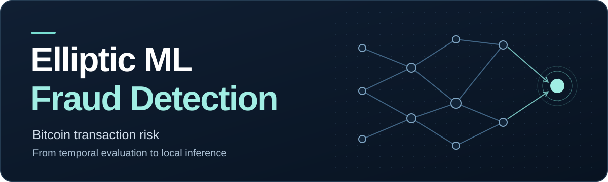
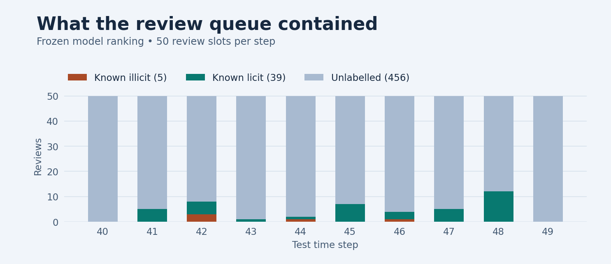
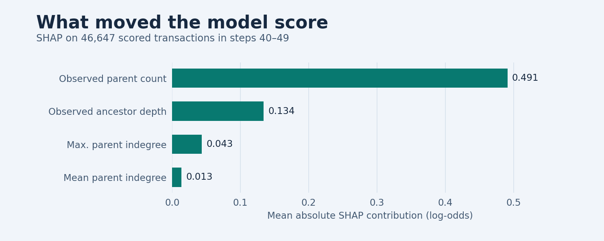
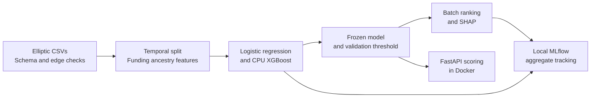
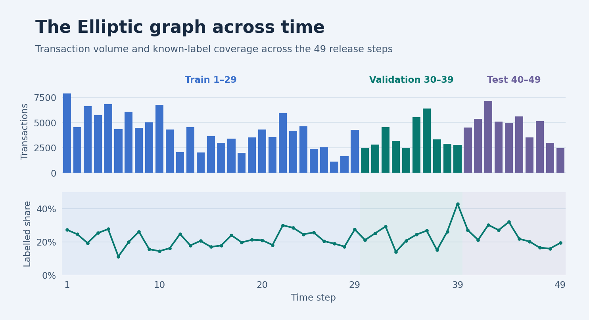
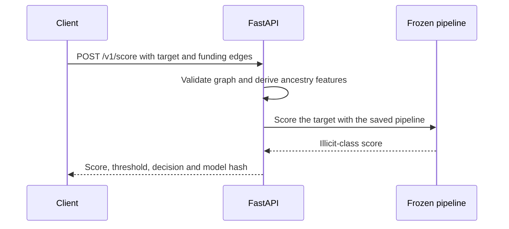
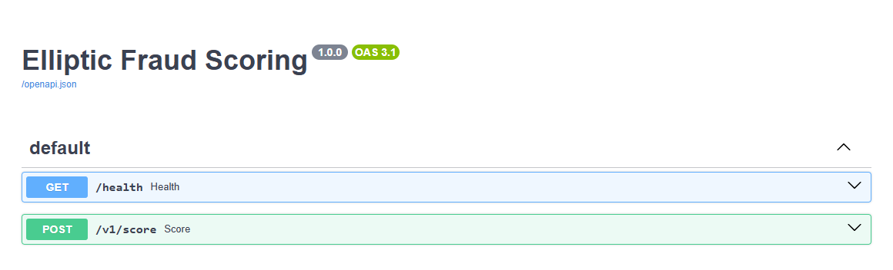

[](https://github.com/Pabloricoc/elliptic-ml-fraud-detection/actions/workflows/ci.yml)
[](#reproduce-the-pipeline)

**An end-to-end ML engineering project for prioritising Bitcoin transactions for analyst review.** It validates the Elliptic graph, builds features from observed funding history, compares models on chronological windows and serves the selected pipeline through a local API. Batch scores feed a capacity-limited review queue with SHAP explanations.

[Results](#results) · [Architecture](#architecture) · [Dataset](#dataset) · [Reproduce](#reproduce-the-pipeline) · [API demo](#serve-the-model) · [Limitations](#limitations)

| Transactions | Directed funding edges | Time steps | Known labels |
| ---: | ---: | ---: | ---: |
| **203,769** | **234,355** | **49** | **46,564** (22.85%) |

## Results

**XGBoost reached 0.0882 average precision on the labelled test subset**, compared with 0.0569 for a constant-score reference. At 50 reviews per time step, the queue captured **5 of 636 known illicit transactions** (0.79%). Average precision measures ranking on known labels. The review budget applies to the full eligible batch.

| Candidate | Validation AP · steps 30–39 | Test AP · steps 40–49 |
| --- | ---: | ---: |
| Standardised logistic regression | 0.1370 | — |
| **CPU XGBoost** | **0.2025** | **0.0882** |

Validation AP selected XGBoost for the test window. The validation-selected threshold of **0.168804** (rounded) yielded **9.23% precision** and **51.57% recall** over 11,184 test transactions with known labels. The held-out queue selected 500 of 46,647 eligible transactions, including 456 with unknown outcomes. The overall precision of that queue remains undetermined. [Split, label policy and full results](docs/evaluation.md#recorded-local-result)



Across all 46,647 scored transactions, **observed parent count** had the largest mean absolute SHAP contribution at **0.491 log-odds**. Each queued transaction also gets its four signed contributions. The scoring command checks that the base value and the contributions reconstruct the model score. [Explanation methodology and recorded batch](docs/scoring.md#recorded-replay)



## Architecture



- **Data engineering.** Parse the headerless CSV, preserve exact transaction IDs, validate the class join and check that each funding edge stays in its own time step.
- **Graph features and temporal validation.** Split by complete time steps before modelling. At confirmation, derive four features from incoming funding ancestry. Fit on steps 1–29, select the model and threshold on 30–39, then evaluate on 40–49.
- **Reproducible scoring.** Use the same feature builder, verified model artifact and saved threshold in the batch job and API. Keep the review budget separate from the threshold decision.
- **MLOps and quality.** Fingerprint the input CSVs and fitted model, track aggregate reports with MLflow and check parity between API and batch scores. GitHub Actions tests synthetic inputs on Ubuntu, Windows and in a Docker HTTP smoke test.

## Dataset

The original Elliptic release contains **4,545 known illicit**, **42,019 known licit** and **157,205 unlabelled** transactions. Unlabelled transactions can supply graph context and enter the review queue. Supervised fitting and evaluation use the known labels.



The graph features use observed parent count, mean and maximum parent indegree, and observed ancestor depth. The 165 anonymous release columns include neighbourhood aggregates whose availability at confirmation is uncertain. The feature allowlist uses incoming ancestry so downstream spending leaves an earlier score unchanged. [Dataset provenance and access terms](data/README.md) · [Feature policy](docs/evaluation.md#phase-2-experiment)

## Reproduce the pipeline

Use Python **3.11 or 3.12**. Run these commands from the repository root.

| Environment | Create and activate a virtual environment |
| --- | --- |
| Windows PowerShell | `py -3.11 -m venv .venv` then `.\.venv\Scripts\Activate.ps1` |
| Linux or macOS | `python3.11 -m venv .venv` then `. .venv/bin/activate` |

```sh
python -m pip install -c constraints-dev.txt -e ".[dev]"
python -m ruff check .
python -m ruff format --check .
python -m pytest
```

The quality checks use synthetic inputs and run without the dataset. On Windows with activation restricted, invoke `.\.venv\Scripts\python.exe` and the CLI executables under `.\.venv\Scripts\` directly.

### Audit, train and track

Place the three original CSVs in `data/raw/`, following the [dataset guide](data/README.md). Use `--data-dir` to select a different local directory.

```sh
elliptic-data validate
elliptic-data analyze
elliptic-train
```

The EDA run writes class, feature and time-step summaries. Training writes the selected model, metrics, per-step queue counts and manifest to a new directory under `artifacts/models/`. Use that output path as `model-<run-id>`. Scoring prints a second run path under `artifacts/scores/`.

```sh
elliptic-score --model-run "artifacts/models/model-<run-id>"
elliptic-track --model-run "artifacts/models/model-<run-id>" --score-run "artifacts/scores/score-<run-id>"
mlflow server --backend-store-uri sqlite:///artifacts/tracking/mlflow.db --host 127.0.0.1 --port 5000
```

Open `http://127.0.0.1:5000` to view the tracked run in MLflow. Review the local score and queue CSVs separately from the aggregate tracking reports. [Batch outputs and tracking](docs/scoring.md)

## Serve the model

With Docker Desktop running Linux containers, build the image and mount your trusted training run read-only. This PowerShell example uses the path printed by `elliptic-train`.

```powershell
$modelRun = (Resolve-Path 'artifacts/models/model-<run-id>').Path
docker build --tag elliptic-fraud:local .
docker run --rm --read-only --publish 127.0.0.1:8000:8000 --mount "type=bind,source=$modelRun,target=/model,readonly" elliptic-fraud:local
```

Open `http://127.0.0.1:8000/docs` for Swagger UI. `GET /health` reports readiness and the loaded model fingerprint. `POST /v1/score` scores one transaction with its observed funding graph.



<details>
<summary>Swagger UI and an actual API response</summary>



This request uses invented IDs and edges. The response below was generated locally by the saved XGBoost model.

```json
{
  "transaction_id": "0004",
  "transactions": ["0001", "0002", "0003", "0004"],
  "funding_edges": [
    {"source_id": "0001", "target_id": "0003"},
    {"source_id": "0002", "target_id": "0004"},
    {"source_id": "0003", "target_id": "0004"}
  ]
}
```

```json
{
  "transaction_id": "0004",
  "risk_score": 0.024288879707455635,
  "threshold": 0.16880415380001068,
  "above_threshold": false,
  "model_sha256": "b66ee19643d20a1af4e7a393d9d9194f163a04869a2997a04d7d7ebfba9e4282"
}
```

</details>

[Serving guide, native launch and container smoke test](docs/serving.md)

## Limitations

- **Selective labels.** 77.15% of the graph is unlabelled. The supervised metrics cover known outcomes, and the queue's 456 unlabelled selections limit conclusions about its yield.
- **Historical coverage.** The release is a retrospective subgraph, and label publication dates are unavailable. Real-time use would need an auditable graph feed and known label delays.
- **Operating point and validation.** The score is uncalibrated. The fixed review budget recovered few known illicit transactions. A larger chronological evaluation with fresher labels would help test stability and compare queue policies.
- **Serving scope.** FastAPI and Docker provide a local demo. Operational use would require separate deployment validation and monitoring.

## Repository guide

| Location | Contents |
| --- | --- |
| [`src/elliptic_fraud/`](src/elliptic_fraud) | CSV validation, graph features, modelling, batch scoring, SHAP, tracking and HTTP inference |
| [`tests/`](tests) and [`scripts/`](scripts) | Offline tests and a synthetic Docker API smoke test |
| [`data/README.md`](data/README.md) | Dataset layout, provenance and usage terms |
| [`docs/`](docs) | Evaluation protocol, scoring and serving guides, portfolio figures and [release preparation](docs/release.md) |
| [`.github/workflows/ci.yml`](.github/workflows/ci.yml) | Automated quality checks on Ubuntu, Windows and Docker |

The dataset, fitted model, transaction-level outputs and MLflow store are generated or supplied locally. The portfolio figures use aggregate statistics from the recorded experiment. [Figure provenance](docs/assets/README.md)
